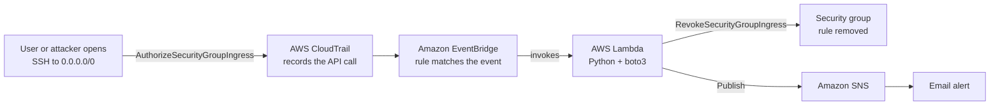
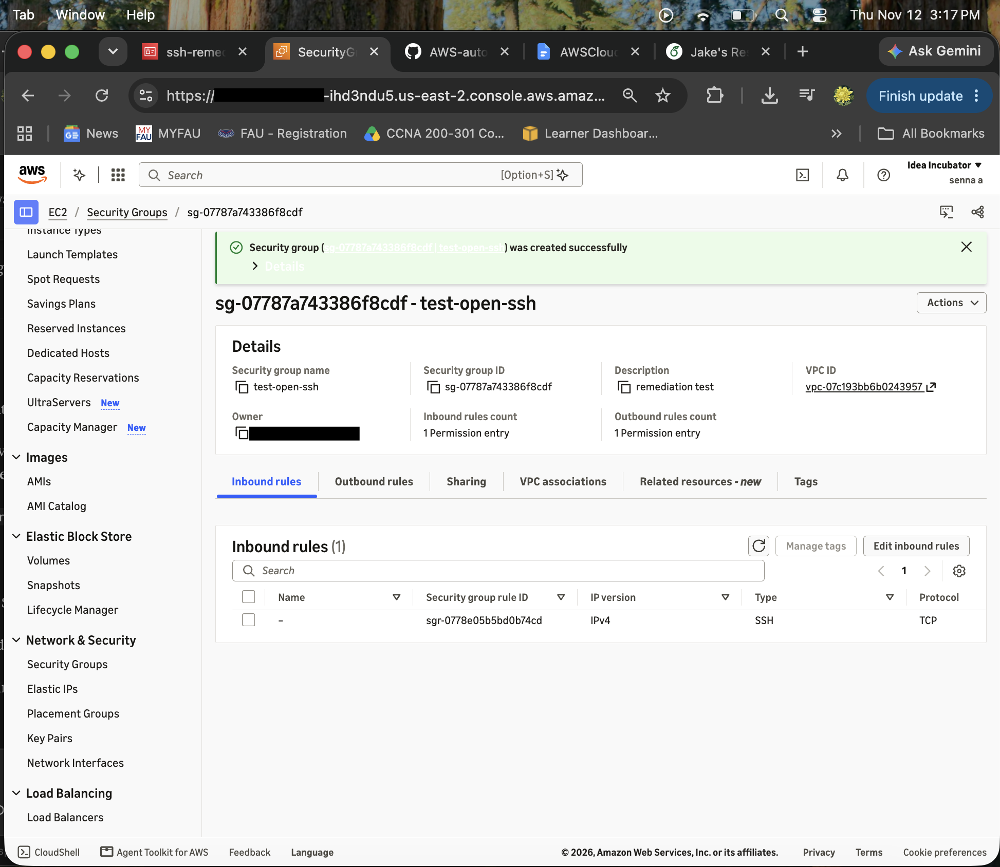
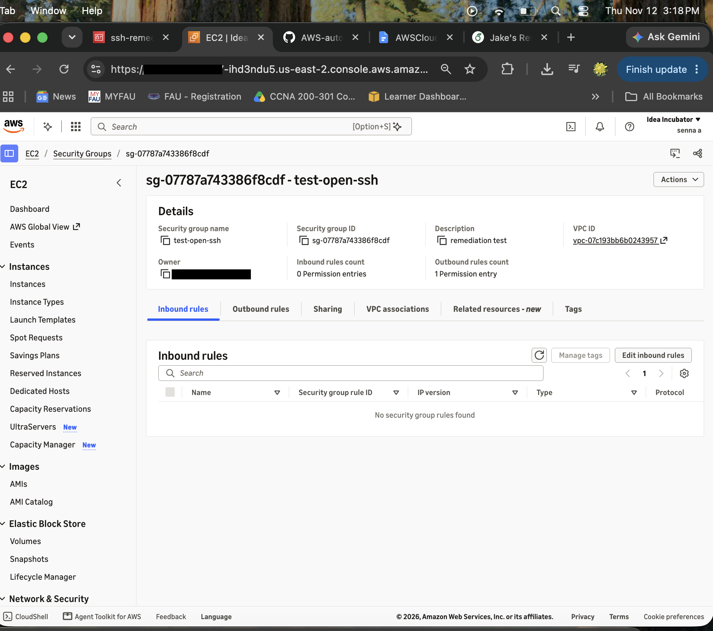
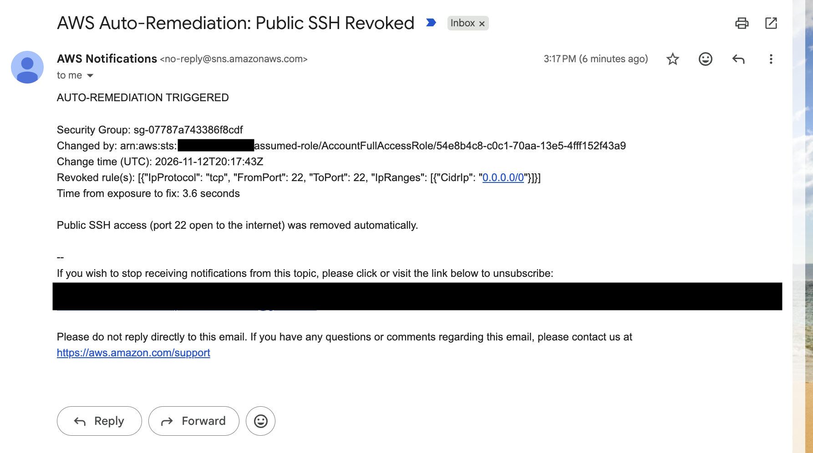
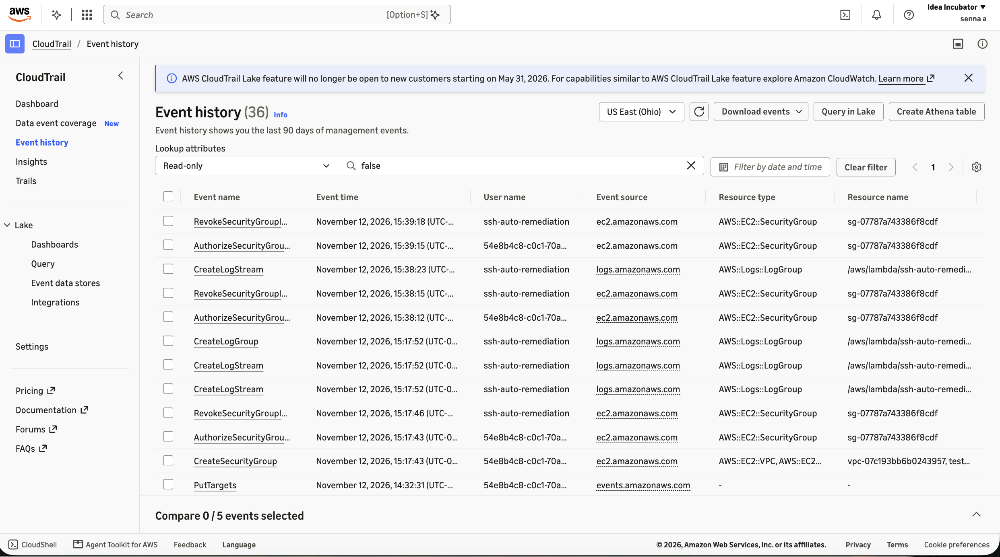

# Automated Cloud Threat Remediation (AWS)

A security workflow that detects when an EC2 security group exposes SSH (port 22) to the entire internet and automatically revokes the rule, with no human intervention. Average time from exposure to fix: **3.6 seconds**.

**Stack:** AWS CloudTrail · Amazon EventBridge · AWS Lambda (Python 3.12, boto3) · Amazon SNS · AWS IAM

---

## The Problem

Every action in AWS is an API call. When someone adds an inbound rule allowing SSH from `0.0.0.0/0`, any host on the internet can attempt to connect, and automated scanners find open port 22 within minutes. A single misclick in the console can create that exposure.

This project closes the gap automatically: it watches for the API call that opens the port and undoes it within seconds.

> **Scope:** The system revokes the overly permissive network rule. It closes the opening an attacker could use; it does not detect or remove an intruder who is already inside.

---

## Architecture



| Component | Role |
|---|---|
| **CloudTrail** | Records every API call in the account |
| **EventBridge** | Matches `AuthorizeSecurityGroupIngress` events in real time |
| **Lambda** | Inspects the new rule and revokes it if it exposes SSH to the internet |
| **SNS** | Emails an incident summary: who made the change, when, and what was revoked |

---

## Detection Logic

The Lambda function ([`lambda/remediate_ssh.py`](lambda/remediate_ssh.py)) parses the CloudTrail event and revokes a rule only if **both** conditions are true:

1. **The rule covers port 22.** This includes:
   - An exact SSH rule (TCP 22)
   - Any TCP port range containing 22 (e.g. `0–65535`)
   - "All traffic" rules (protocol `-1`)
2. **The source is the whole internet.** Either `0.0.0.0/0` (IPv4) or `::/0` (IPv6).

Rules scoped to specific IPs (e.g. `203.0.113.5/32`) are left untouched, so legitimate admin access keeps working. Failed API calls (events with an `errorCode`) are skipped.

---

## Results

Tested by repeatedly adding an SSH rule open to `0.0.0.0/0` on a test security group:

| Test | Opened (UTC) | Exposure to fix |
|---|---|---|
| 1 | 20:17:43 | 3.6 s |
| 2 | 20:38:12 | 3.8 s |
| 3 | 20:39:15 | 3.5 s |
| **Average** | | **3.6 s** |

**Independent verification:** CloudTrail Event history shows each `AuthorizeSecurityGroupIngress` (by my user session) followed ~3 seconds later by a `RevokeSecurityGroupIngress` performed by the `ssh-auto-remediation` function, confirming the system acted, not a human.

**Where the time goes:** The Lambda itself runs in about 0.8 seconds (CloudWatch average duration ~805 ms). Most of the remaining time is CloudTrail delivering the event to EventBridge.

### Evidence

| Rule opened | Rule automatically revoked |
|---|---|
|  |  |

**Email alert** (sent by Lambda via SNS):



**CloudTrail audit trail** (each revoke attributed to the Lambda function):



---

## Security Design

The Lambda runs under a dedicated IAM role built on **least privilege** ([`iam/lambda-inline-policy.json`](iam/lambda-inline-policy.json)):

| Permission | Scope | Why |
|---|---|---|
| `ec2:DescribeSecurityGroups` | `*` (AWS does not support narrower scoping) | Inspect security groups |
| `ec2:RevokeSecurityGroupIngress` | Security groups in this account and region only | Remove the risky rule |
| `sns:Publish` | The `SecurityAlerts` topic only | Send the alert |
| `AWSLambdaBasicExecutionRole` | Managed policy | Write logs to CloudWatch |

The role's trust policy allows only the Lambda service to assume it. If the function were ever compromised, it could not read data, launch resources, or publish to any other topic.

---

## Repository Structure

```
├── lambda/remediate_ssh.py          # Remediation function (Python 3.12, boto3)
├── eventbridge/event-pattern.json   # EventBridge rule pattern
├── iam/lambda-inline-policy.json    # Least-privilege inline policy
├── docs/build-log.md                # Step-by-step build log with screenshots
└── screenshots/                     # Evidence from setup and testing
```

For the full build process, including issues I hit and how I fixed them, see the **[build log](docs/build-log.md)**.

---

## Deployment Summary

All resources are in one region (`us-east-2`), since EventBridge only receives events from its own region.

1. **CloudTrail:** Create a trail logging management events.
2. **SNS:** Create a Standard topic (`SecurityAlerts`) and confirm an email subscription.
3. **IAM:** Create a Lambda execution role with `AWSLambdaBasicExecutionRole` plus the inline policy in `iam/`. Replace `ACCOUNT_ID` with your account ID.
4. **Lambda:** Create a Python 3.12 function with the code in `lambda/`, set the environment variable `SNS_TOPIC_ARN` to the **topic** ARN, and raise the timeout to 15 seconds.
5. **EventBridge:** Create a rule on the default event bus using the pattern in `eventbridge/`, targeting the Lambda function.
6. **Test:** Add an inbound SSH rule from `0.0.0.0/0` to a test security group and watch it disappear.

---

## Lessons Learned

- **Topic ARN vs. subscription ARN.** I first scoped the IAM policy to the SNS *subscription* ARN, which would have caused an `AccessDenied` on publish. Lambda publishes to the *topic*, not to an individual subscriber.
- **Event pattern precision.** An EventBridge pattern must match exactly. A malformed `eventSource` value matches nothing and fails silently.
- **Scheduled vs. event-pattern rules.** EventBridge has both. Scheduled rules fire on a timer; this project needs an event-pattern rule that fires when a matching event arrives.

---

## Limitations & Future Improvements

- **Other ways to open a port.** The rule watches `AuthorizeSecurityGroupIngress`. The `ModifySecurityGroupRules` API can also change an existing rule to `0.0.0.0/0` and should be added to the pattern.
- **More risky ports.** Extend detection to RDP (3389) and database ports (3306, 5432).
- **Tamper resistance.** A user with admin rights could disable the EventBridge rule or the Lambda. An organization-level Service Control Policy could prevent that.
- **Broader threat detection.** Route Amazon GuardDuty findings into the same SNS alerting flow (GuardDuty was unavailable on the account used for this build).
- **Infrastructure as code.** Define the whole stack in Terraform or CloudFormation so it can be deployed and torn down with one command.

---

## Cost

Built within the AWS Free Tier, with a zero-spend budget alarm as a cost guardrail. Lambda, EventBridge, and SNS cost nothing at this volume; the only ongoing cost is minimal S3 storage for CloudTrail logs.
