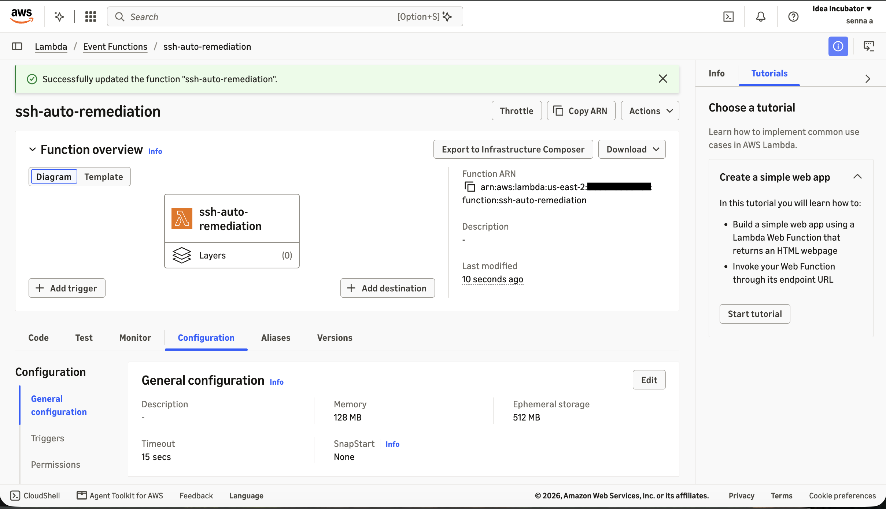
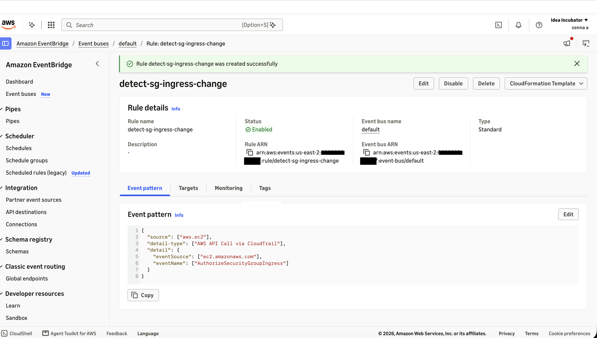
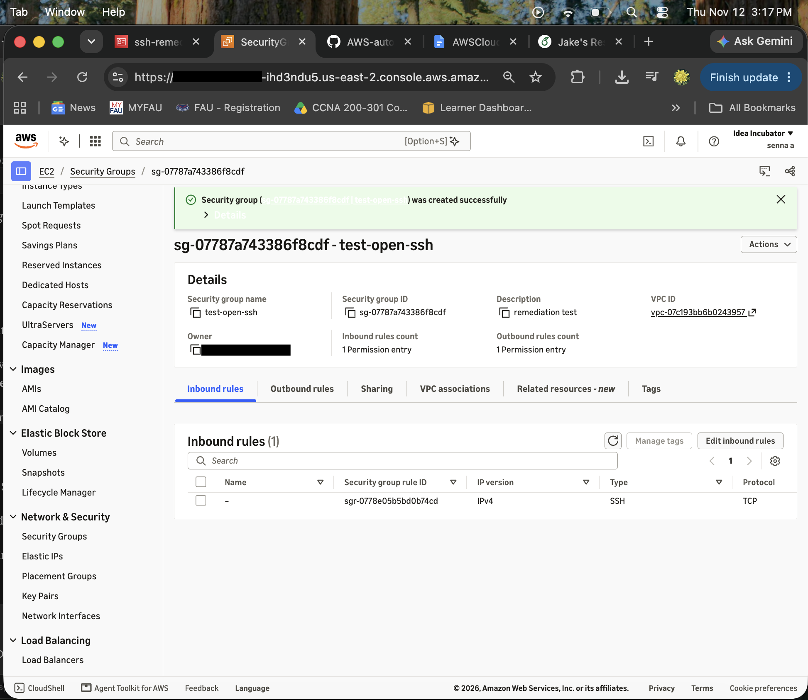
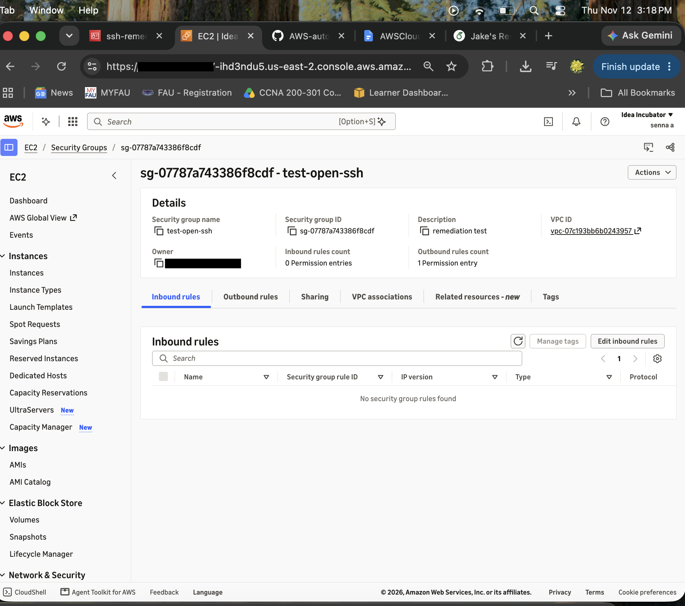
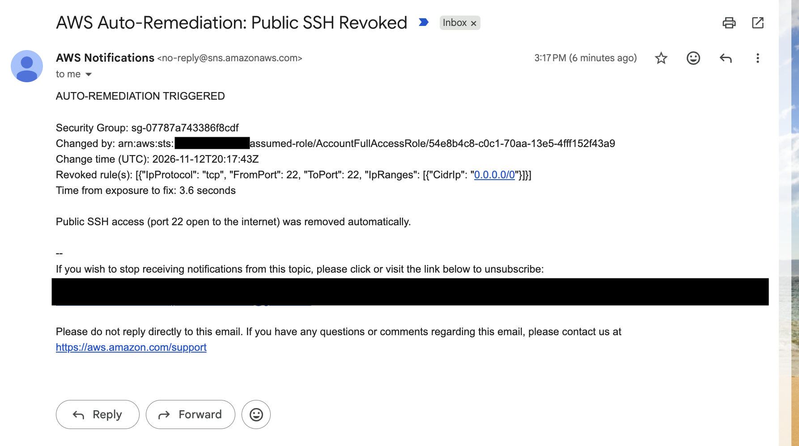

## Build Log

**Region:** us-east-2 (US East, Ohio)

---

### 1. Zero-Spend Budget
- Created a Zero-Spend budget in AWS Budgets that emails me if spending exceeds $0.01.
- Purpose is to cost guardrail so any resource that leaves the Free Tier is caught immediately.
  

### 2. CloudTrail Trail
- Created a multi-region trail `security-audit-trail` that logs management events to an S3 bucket.
- CloudTrail records every API call in the account. It's the event source the detection pipeline listens to.
- Trail status shows Logging.

### 3. GuardDuty (skipped)
- Attempted to enable Amazon GuardDuty for threat detection.
- Blocked by an organization-level restriction on this account ("Access to this service is not supported").
- Proceeded without it. Detection is handled by CloudTrail + EventBridge pattern matching.

### 4. SNS Topic and Email Subscription
- Created a Standard SNS topic `SecurityAlerts` and subscribed my email.
- Lambda will publish a message to this topic after each remediation, and SNS delivers it to every subscriber.
  

### 5. IAM Role for Lambda
- Created role `ssh-remediation-lambda-role` with a trust policy allowing only Lambda to assume it.
- **Permissions:** `AWSLambdaBasicExecutionRole` (CloudWatch logging) plus an inline policy allowing `ec2:DescribeSecurityGroups`, `ec2:RevokeSecurityGroupIngress`, and `sns:Publish` scoped to the `SecurityAlerts` topic.
- Least privilege. The function can only do the exact actions remediation needs.
- Initially used the SNS *subscription* ARN in the IAM policy. Corrected to the *topic* ARN, since Lambda publishes to the topic, not to an individual subscriber.

### 6. Lambda Function
- Created `ssh-auto-remediation` (Python 3.12) using the `ssh-remediation-lambda-role` execution role.
- **Config:** Added environment variable `SNS_TOPIC_ARN` (topic ARN, not subscription ARN). Raised timeout from 3s to 15s to avoid cold-start cutoffs.
  

### 7. EventBridge Rule
- Created rule `detect-sg-ingress-change` on the default event bus, targeting the `ssh-auto-remediation` Lambda.
- It matches CloudTrail-recorded EC2 API calls where `eventName` is `AuthorizeSecurityGroupIngress`.
- This API call adds an inbound rule to a security group, the moment a port gets opened.
- Initially opened "Scheduled rules (legacy)," which is for timer-based rules. Switched to an event-pattern rule via Event buses → default. Used the Advanced builder to paste the JSON pattern.

### 8. Test 1: Public SSH Exposure 
- Created security group `test-open-ssh` with an inbound rule allowing SSH (TCP 22) from `0.0.0.0/0`.
- Rule was automatically revoked and an email alert was delivered.

| Time (EST) | Event |
|---|---|
| 3:17:43 PM | SSH rule opened to `0.0.0.0/0` (CloudTrail eventTime `20:17:43Z` UTC) |
| ~3:17:47 PM | Lambda revoked the rule (measured: **3.6 seconds** after exposure) |
| 3:17 PM | SNS email alert received |
| 3:18 PM | Console confirmed: 0 inbound rules |

- **Note:** Timestamps in AWS events are UTC.

### 9. More Tests: Public SSH Exposure 
| Test | Remediation time |
|---|---|
| 1 | 3.6 s |
| 2 | 3.8 s|
| 3 | 3.5 s|
| **Average** | 3.6 s|

---

## Repo Setup
- Created folder structure: `lambda/`, `eventbridge/`, `iam/`, `docs/`, `screenshots/`.
- Used `.gitkeep` to keep the empty `screenshots/` folder, since Git doesn't track empty folders.
