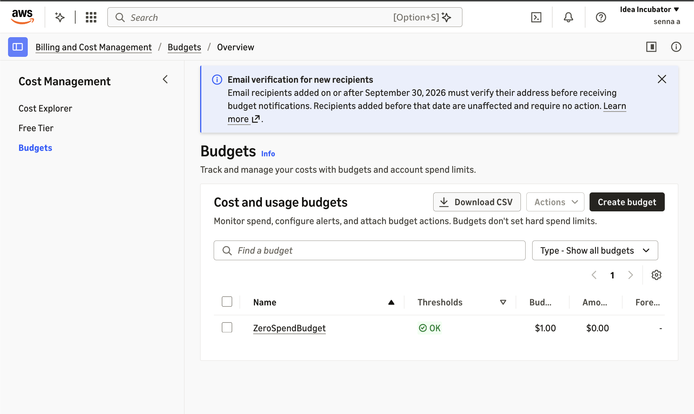
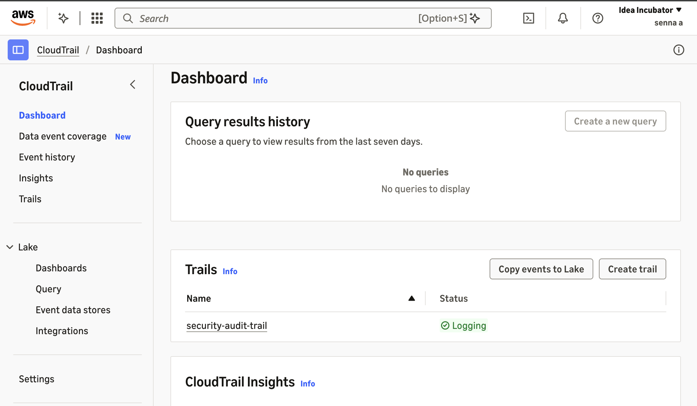
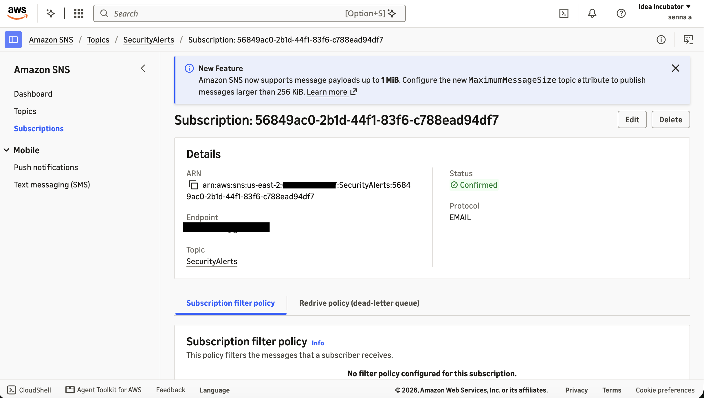
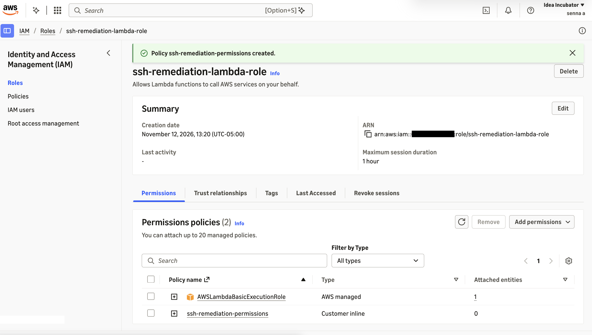

## Build Log
# Build Log

**Region:** us-east-2 (US East, Ohio)

---

## Phase 1: Safety & Logging Setup — Nov 12, 2026

### 1. Zero-Spend Budget
- **What:** Created a Zero-Spend budget in AWS Budgets that emails me if spending exceeds $0.01.
- **Why:** Cost guardrail so any resource that leaves the Free Tier is caught immediately.
- **Result:** Budget `ZeroSpendBudget` shows status OK at $0.00 spent.
- **Issue:** AWS now requires new email recipients to verify their address before alerts are delivered. Verified via the email link.
  

### 2. CloudTrail Trail
- **What:** Created a multi-region trail `security-audit-trail` that logs management events to an S3 bucket.
- **Why:** CloudTrail records every API call in the account. It's the event source the detection pipeline listens to.
- **Result:** Trail status shows Logging.

### 3. GuardDuty (skipped)
- **What:** Attempted to enable Amazon GuardDuty for threat detection.
- **Result:** Blocked: "Access to this service is not supported." The account is managed by an organization that restricts this service (likely via a Service Control Policy).
- **Decision:** Proceeded without it. Detection is handled by CloudTrail + EventBridge pattern matching.

## Phase 2: Notification System (SNS)

### 4. SNS Topic and Email Subscription
- **What:** Created a Standard SNS topic `SecurityAlerts` and subscribed my email.
- **Why:** SNS is the alerting channel. Lambda will publish a message to this topic after each remediation, and SNS delivers it to every subscriber.
- **Result:** Subscription status shows Confirmed.
  

## Phase 3: Permissions (IAM)

### 5. IAM Role for Lambda
- **What:** Created role `ssh-remediation-lambda-role` with a trust policy allowing only Lambda to assume it.
- **Permissions:** `AWSLambdaBasicExecutionRole` (CloudWatch logging) plus an inline policy allowing `ec2:DescribeSecurityGroups`, `ec2:RevokeSecurityGroupIngress`, and `sns:Publish` scoped to the `SecurityAlerts` topic.
- **Why:** Least privilege. The function can only do the exact actions remediation needs.

---

## Repo Setup
- Created folder structure: `lambda/`, `eventbridge/`, `iam/`, `docs/`, `screenshots/`.
- Used `.gitkeep` to keep the empty `screenshots/` folder, since Git doesn't track empty folders.
